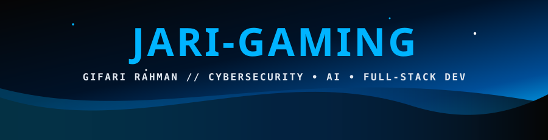

<!-- ========================================================= -->
<!--              JARI-GAMING // BLUE TEAM & SEC OPS           -->
<!-- ========================================================= -->

  

  

  
  
  

---

## `> whoami`

<b>▶ klik untuk buka / tutup profil</b>

 

| FIELD | VALUE |
|---|---|
|  | Gifari Rahman (`jari-gaming`) |
|  | Informatics Engineering Student · Developer · CTF Player |
|  | Cybersecurity · Web & Backend APIs · AI & Data Science |
|  | Web Exploitation · Network Security · Machine Learning |
|  | Linux · Kali Linux · Windows |
|  | Python · TypeScript · JavaScript · SQL · Supabase · Burp Suite · Nmap |
|  | Makassar, Indonesia 🇮🇩 (UIN Alauddin Makassar) |
|  | Building, auditing, and investigating the unknown... |

> **`"The quieter you become, the more you are able to hear — and build."`**

---

### `> focus --vector`

  
  
  

<b>▶ [01] Cybersecurity & Application Security</b>

- Web Application Security & WAF
- REST API Authentication & JWT Hardening
- Password Cracking & Hash Analysis (John the Ripper)
- Phishing Analysis & Data Privacy Awareness
- Network Reconnaissance

<b>▶ [02] Software & Web Engineering</b>

- Full-Stack Web Development (TypeScript / JavaScript / HTML / CSS)
- Backend Architecture & SOLID Principles
- Database Design & Query Optimization (PostgreSQL / MySQL / Supabase)
- Cloud Deployment (AWS / Vercel)

<b>▶ [03] AI & Data Science</b>

- Exploratory Data Analysis & Preprocessing (Pandas / NumPy)
- Machine Learning Workflows & Model Evaluation
- Business Intelligence & Interactive Dashboards (Power BI)
- Certified: Dicoding Dasar AI & Dasar Data Science

<b>▶ [04] CTF & Security Challenges</b>

- Web Exploitation
- Cryptography & Hash Cracking
- Digital Forensics & OSINT
- Custom CTF Platform Development (`project-ctf`)

---

### `> arsenal --list`

**01 // Operating Systems**

  
  
  

**02 // Programming & Scripting**

  
  
  
  
  

**03 // Web, Data & Cloud**

  
  
  
  
  
  

**04 // Security & Recon Tools**

  
  
  
  
  

---

### `> ctf --telemetry`

  

---

### `> github --telemetry`

  
  

  <picture>
    <source media="(prefers-color-scheme: dark)" srcset="https://raw.githubusercontent.com/jari-gaming/jari-gaming/output/github-contribution-grid-snake-dark.svg"/>
    <source media="(prefers-color-scheme: light)" srcset="https://raw.githubusercontent.com/jari-gaming/jari-gaming/output/github-contribution-grid-snake.svg"/>
    
  </picture>

---

### `> research --active`

<b>▶ klik untuk buka daftar riset & proyek aktif</b>

**[01] Cybersecurity & CTF**
- Custom CTF Challenge Platform (`project-ctf`)
- Web Application Firewalls (WAF) & Endpoint Protection
- Authentication Security & Token Hardening
- Data Privacy & Phishing Defense

**[02] AI & Data Science**
- Exploratory Data Analysis with Python, Pandas & SQL
- Machine Learning Pipelines & Google Colab Experiments
- Interactive BI Dashboards (Power BI)

**[03] Full-Stack & Backend Engineering**
- Clean Architecture & SOLID Principles
- Supabase & PostgreSQL Backend Integration
- Collaborative Web Showcase (`PresentasiKarya`)

**[04] Learning & Training Platforms**
- Dicoding Indonesia (Certified in AI & Data Science)
- MySkill & Coursera
- PicoCTF / TryHackMe / Cyber Labs

---

### `> philosophy --execute`

  

---

### `> connect --secure`

  
  
  
  

  

<!-- Animated Blue Team Footer -->

  

  <code>[!] PAYLOAD EXECUTED // CONNECTION TERMINATED // JARI-GAMING</code>

